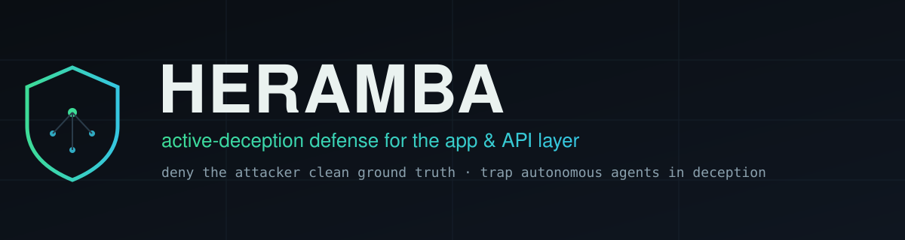
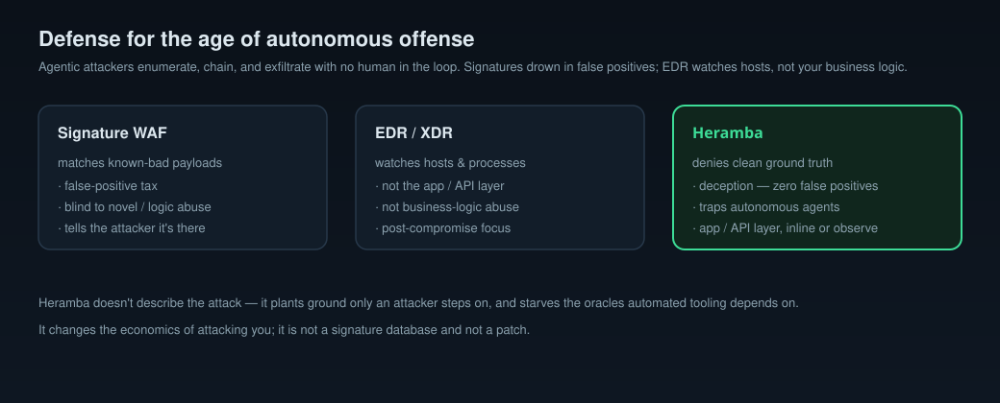
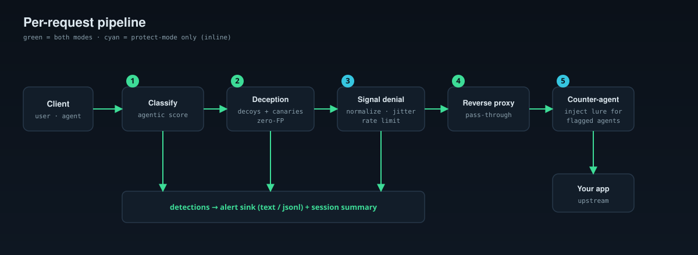
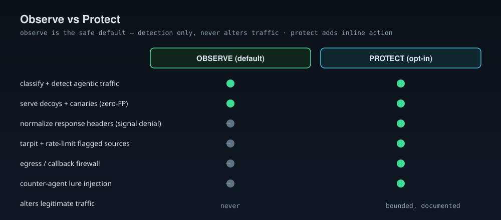
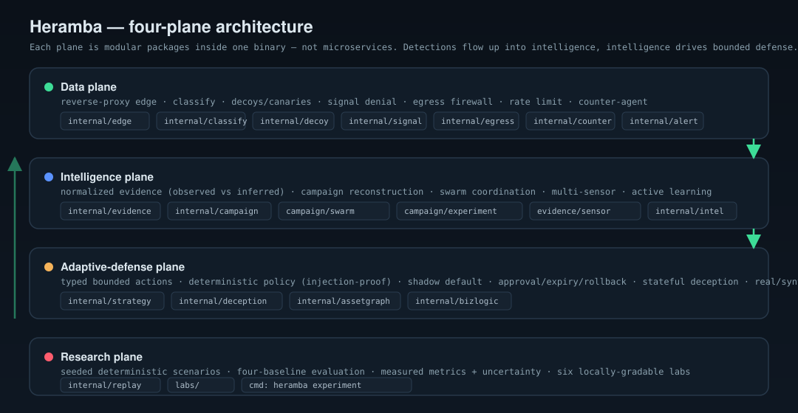
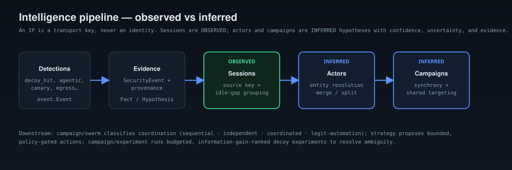
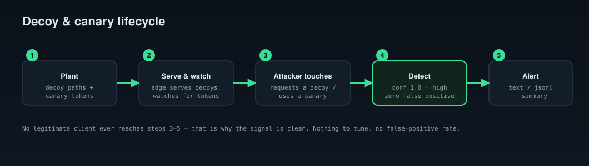
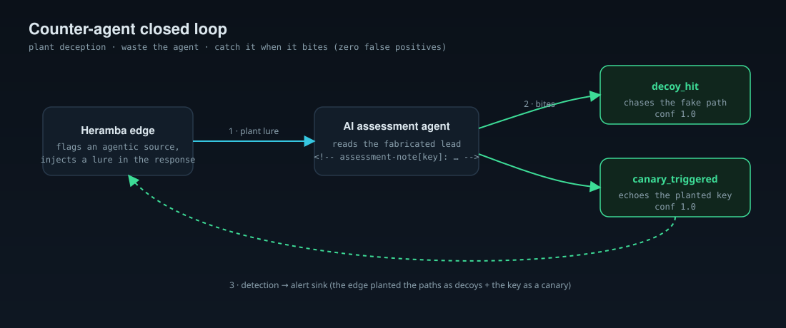
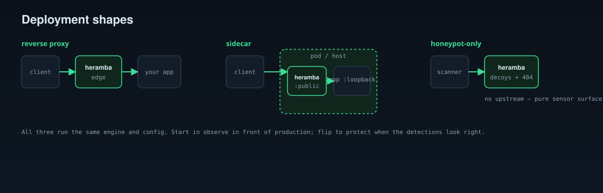
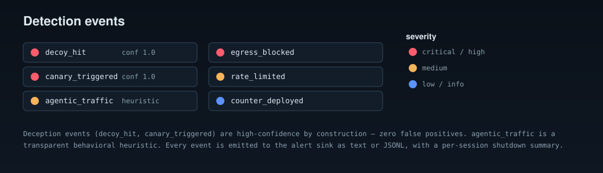

<div align="center">



<p>
  
  
  
  
  
</p>

**Active-deception & counter-agent defense for the app/API layer.**
Deny the attacker clean ground truth — and trap autonomous agents in deception —
instead of matching payloads (WAF) or watching hosts (EDR).

</div>

---

> **Status: pre-release.** The engine's core is real and tested (see *What's
> shipped* below), but this is early. **Observe mode is safe to run in front of
> production** — it only watches. Every feature here is honestly marked
> *shipped* or *planned*; nothing claims a defense it doesn't have.

## At a glance

| | |
|---|---|
| 🪤 **Deception surface** | decoy endpoints + cryptographic canary tokens — a hit is an attacker, **zero false positives** |
| 🤖 **Agentic-traffic classifier** | deterministic, explainable signals score how automated a source is — **no LLM on the hot path** |
| 🙈 **Signal denial** | strip fingerprinting headers + timing jitter so automated oracles lose their ground truth |
| 🧲 **Counter-agent lures** | inject fabricated leads for flagged AI agents — the fake paths become decoys, the key a canary |
| 🚧 **Egress firewall + rate limit** | deny-by-default outbound (cut SSRF/OOB/exfil) and throttle abusive sources |
| 🛡️ **Observe-first** | detection-only by default; inline **protect** is explicit opt-in |

## Why



Offense is going autonomous. Agentic attack tools enumerate your surface, chain
weaknesses, and exfiltrate **without a human in the loop** — fast, tireless, and
relentless at probing. Signature WAFs answer with payload matching and drown you
in false positives; EDR watches hosts, not your app's business logic.

Heramba takes the other road. It sits at the edge and:

- **plants deception** — decoy endpoints and canary tokens that *no legitimate
  client ever touches*, so a hit is an attacker with **zero false positives**;
- **denies signal** — strips fingerprinting headers and blunts timing oracles,
  so automated tooling loses the clean ground truth it depends on;
- **spots the robot** — scores how agentic a source looks from transparent,
  deterministic behavioral signals (no LLM on the hot path).

Autonomous attackers are *especially* vulnerable to this: they enumerate
aggressively and walk straight into the decoys.

## Quickstart

```bash
go install github.com/Armur-Ai/heramba/cmd/heramba@latest   # or: make build

heramba config init          # writes a commented .heramba.yml (observe mode)
heramba doctor               # advisory readiness check
heramba serve                # run the edge in front of your app
```

Point your ingress at Heramba's `listen` address; it forwards real traffic to
your `upstream` untouched (observe mode) and logs detections. Probe a decoy and
watch it fire:

```console
$ heramba serve --listen 127.0.0.1:8080 &
$ curl -s -o /dev/null http://127.0.0.1:8080/.env
[02:01:38] high decoy_hit src=127.0.0.1 target="/.env" conf=1.00 GET /.env — decoy (environment/secret file probe)
```

## How it works

Every request flows through the edge runtime: **classify** the source →
**deception** check (decoys/canaries) → **signal denial** (protect mode) →
**reverse proxy** to your app. Outbound, an **egress firewall** (protect mode)
enforces a deny-by-default allowlist.



### Observe vs protect

Observe is the safe default and **never alters legitimate traffic** — so you can
run it in front of production and measure before enabling any inline behavior.



| | observe (default) | protect (opt-in) |
|---|---|---|
| classify + detect | ✅ | ✅ |
| serve decoys / canaries | ✅ | ✅ |
| rewrite real responses | ❌ passthrough | ✅ normalize |
| tarpit flagged sources | ❌ | ✅ |
| egress firewall | ❌ | ✅ |

See the full [architecture](docs/architecture.md). Beyond the edge, Heramba is
organized into four planes — data, intelligence, adaptive-defense, research:



Detections flow up into an evidence model that keeps **what was observed**
(sessions) distinct from **what is inferred** (actors, campaigns):



Full write-up: [the four planes](docs/architecture/planes.md).

## Decoys & canaries

No legitimate client ever reaches the decoy surface — that's why the signal is
clean. Nothing to tune, no false-positive rate.



```bash
heramba decoys list                 # the active lure surface
heramba decoys canary db-password   # mint a plantable canary token
```

More: [decoys & canaries](docs/decoys.md).

## Counter-agent deception

Autonomous assessment agents read and reason over responses, then chase the best
leads. In protect mode Heramba injects **fabricated** vulnerability leads for
sources the classifier flags — invisible to humans — then **catches the agent
that chases them**: the fake paths are registered as decoys and the lure key is
watched as a canary.



Inspired by static injectors like
[SpikeStrip](https://github.com/Arcanum-Sec/SpikeStrip), applied at runtime and
closed-loop. More: [counter-agent deception](docs/counter-agent.md).

## Deploy



Reverse proxy in front of your app, sidecar in the same pod, or honeypot-only
(no upstream). Same binary, same config. Full guide: [deployment](docs/deployment.md).

## Detections



Detections stream to an alert sink as text or JSONL, with a per-session
shutdown summary. Details: [metrics & alerting](docs/metrics.md).

## What's shipped vs planned

**Data plane — shipped (real, tested, live in `serve`):**
- ✅ Reverse-proxy edge runtime with observe/protect modes
- ✅ Decoy endpoints + registry, zero-FP `decoy_hit` detection
- ✅ Cryptographic canary tokens + edge detection (path/query/headers/body)
- ✅ **Counter-agent prompt decoys** — inject fabricated leads for flagged AI agents; the fake paths become decoys + the key a canary (protect mode)
- ✅ Deterministic, **configurable** agentic-traffic classifier (explainable signals)
- ✅ Signal denial: response-header normalization + timing jitter
- ✅ Deny-by-default egress/callback firewall + per-source rate limiting (protect mode)
- ✅ Alert sinks (text / JSONL) + detection counting/summary; CLI (`serve`/`decoys`/`config`/`doctor`/`experiment`)

**Intelligence plane — shipped, tested; evidence→campaign→swarm live-wired into `serve`:**
- ✅ Normalized evidence model (`Observation`/`Fact`/`Hypothesis`) with provenance, validation, append-only persistence
- ✅ Temporal **campaign reconstruction**: sessions (observed) vs actors/campaigns (inferred), never equating an IP with an identity; merge/split correction; explainable timelines
- ✅ **Swarm-coordination detection** (sequential / independent / coordinated / legit-automation) — synchrony + shared/divided targeting + enumeration, *not* UA or rate alone
- ✅ Business-logic detection (BOLA/IDOR + workflow-sequence abuse) via OpenAPI ingest
- ✅ Multi-sensor correlation (app / auth / network) with dedup, health, backpressure
- ✅ Bounded **active learning** (competing hypotheses, info-gain, budget)

**Adaptive-defense & research planes — shipped as tested libraries + labs + `heramba experiment`:**
- ✅ Deterministic policy + bounded **adaptive containment** (shadow default, approval/expiry/rollback, emergency disable, injection-proof)
- ✅ Stateful **deception app** (seeded coherent synthetic world, production-isolated)
- ✅ Defender-controlled real/synthetic **attack graphs** (real graph fails closed on export)
- ✅ Reproducible **four-baseline evaluation** harness with measured metrics + uncertainty
- ✅ Six locally-gradable **conference labs** (`labs/`)

See the full [capability matrix](docs/engineering/EXECUTION_STATUS.md) and
[implementation plan](docs/architecture/implementation-plan.md).

**Research & assurance (Phase 2 — shipped, tested):** a pre-registered,
leakage-checked protocol and reproducible experiments quantify the claims above
(H1–H5), with honest targets-vs-observed accounting. See the
[research report](docs/research/research-report.md),
[capability matrix](docs/research/capability-matrix.md), and
[assurance report](docs/security/assurance-report.md). Run them:

```bash
heramba research coord       # H1: coordination detection (4 methods + ablations)
heramba research objective   # H2: deception vs attacker objective (5 arms)
heramba research coevolve    # H3: adaptation race & ablations
heramba research stats       # targets-vs-observed scorecard
```

**Planned / next integration steps (tracked honestly):**
- ◻ Auto-mount the deception app and run the strategy engine inline from `serve`
- ◻ More classifier signals (JA3/TLS, header-order fingerprint)
- ◻ Content-level deception; **online** deception-policy optimization (offline evaluator shipped)
- ◻ Drive coordination FPR to the 1% target (currently ~9% on hard synthetic benign); finish H4 missing-sensor sweep
- ◻ More alert sinks (Slack/SIEM; webhook sink shipped); signed releases / SLSA provenance

See the [CHANGELOG](CHANGELOG.md). Deep dives:
[architecture](docs/architecture.md) · [four planes](docs/architecture/planes.md) ·
[evidence model](docs/evidence.md) · [campaign intelligence](docs/campaign.md) ·
[strategy & containment](docs/strategy.md) · [decoys & canaries](docs/decoys.md) ·
[classifier](docs/classifier.md) · [signal denial](docs/signal-denial.md) ·
[counter-agent](docs/counter-agent.md) · [metrics](docs/metrics.md) ·
[deployment](docs/deployment.md) · [threat model](docs/threat-model.md) ·
[research protocol](docs/research/protocol.md) · [reproducibility](docs/research/reproducibility.md) ·
[labs](labs/)

## Open source vs commercial

The engine is genuinely useful standalone and stays that way. The commercial
tier adds what's valuable at scale and can't be copied off a laptop —
AI-augmented classification, believable decoy *content*, managed cross-customer
threat intelligence, and hosted operations. The OSS engine never has a basic
withheld; it just doesn't ship the premium layers. (Boundary and rationale:
[docs/](docs/).)

## Safety & responsible use

Heramba is **defensive**. Observe mode is the default and never alters or blocks
legitimate traffic. Protect mode's inline actions are bounded and documented. No
LLM sits on the detection path, so nothing an attacker sends can prompt-inject
the decision. The counter-agent lures are false *bait*, never a payload aimed at
the agent's host. Report vulnerabilities via [SECURITY.md](SECURITY.md).

## Contributing & license

Contributions welcome — see [CONTRIBUTING.md](CONTRIBUTING.md) (CLA required).
Licensed under **FSL-1.1-ALv2** (converts to Apache-2.0 two years after each
release); see [LICENSE](LICENSE) and [NOTICE](NOTICE).

<div align="center"><sub>Heramba is part of the Armur security suite.</sub></div>
