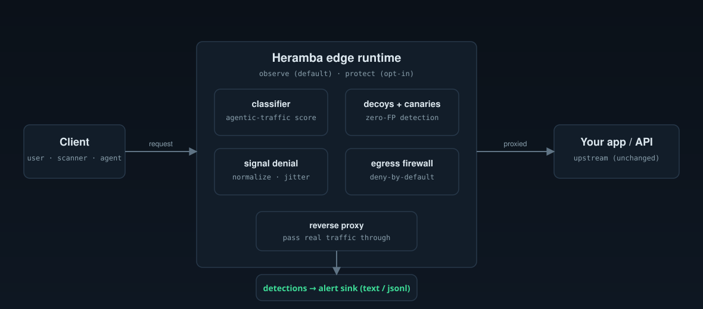

# Architecture

Heramba is an **edge runtime** — a reverse proxy / sidecar you place in front of
an app or API. Every request flows through four cooperating components; the
engine emits **detection events** and, in protect mode, acts inline.

## Request lifecycle

1. **Classify** (`internal/classify`) — score how automated/agentic the source
   looks from deterministic signals (cadence, client fingerprint, missing
   browser signals, enumeration shape). Runs in both modes; emits an
   `agentic_traffic` event when a source crosses threshold.
2. **Deception surface** (`internal/decoy`) — if the path is a decoy, emit a
   zero-false-positive `decoy_hit` and serve a neutral 404. Canary tokens
   (`internal/decoy`) are checked the same way. Always active.
3. **Signal denial** (`internal/signal`, protect mode) — normalize response
   headers to deny fingerprinting, and tarpit sources the classifier flagged.
4. **Reverse proxy** — pass real application traffic to the upstream. In observe
   mode this is a clean passthrough; in protect mode responses are normalized.
   With no upstream configured the edge is **honeypot-only** (decoys + 404).

Outbound, the **egress firewall** (`internal/egress`, protect mode) enforces a
deny-by-default allowlist on connections the app makes, cutting SSRF/OOB
callbacks and exfiltration.

Detections are delivered through an **alert sink** (`internal/alert`): text or
JSONL, stdout or file, with fan-out.

## Modes

| | observe (default) | protect (opt-in) |
|---|---|---|
| classify + detect | ✅ | ✅ |
| serve decoys / canaries | ✅ | ✅ |
| rewrite real responses | ❌ (passthrough) | ✅ (normalize) |
| tarpit flagged sources | ❌ | ✅ |
| egress firewall | ❌ | ✅ (if enabled) |

**Observe is safe to deploy in front of production first** — it never alters or
blocks legitimate traffic. Turn on protect once you trust the detections.

## Design principles

- **Deterministic detection path.** The classifier and decoys are pure,
  offline, reproducible logic. No LLM sits on the request path (can't be slow,
  can't be prompt-injected). AI augmentation is a separate commercial layer.
- **Zero false positives by construction.** A decoy hit or canary use is
  high-confidence because nothing legitimate touches them — not because a model
  is confident.
- **Minimal, auditable core.** Standard library plus one YAML dependency. No
  database required; the engine is stateless beyond per-source cadence memory.

## Package map

| Package | Responsibility |
|---|---|
| `internal/edge` | the reverse-proxy runtime; wires everything together |
| `internal/classify` | deterministic agentic-traffic classifier |
| `internal/decoy` | decoy endpoints + canary tokens + zero-FP detection |
| `internal/signal` | response normalization + timing jitter |
| `internal/egress` | deny-by-default egress/callback firewall |
| `internal/event` | the detection event model |
| `internal/alert` | alert sinks (text / jsonl / multi) |
| `internal/config` | `.heramba.yml` loading + validation |
| `cmd/heramba` | the CLI (`serve`, `decoys`, `config`, `doctor`) |
