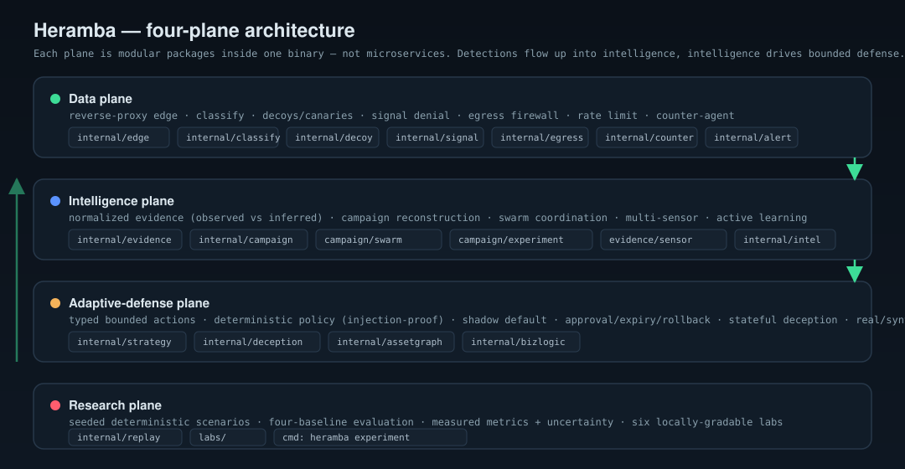
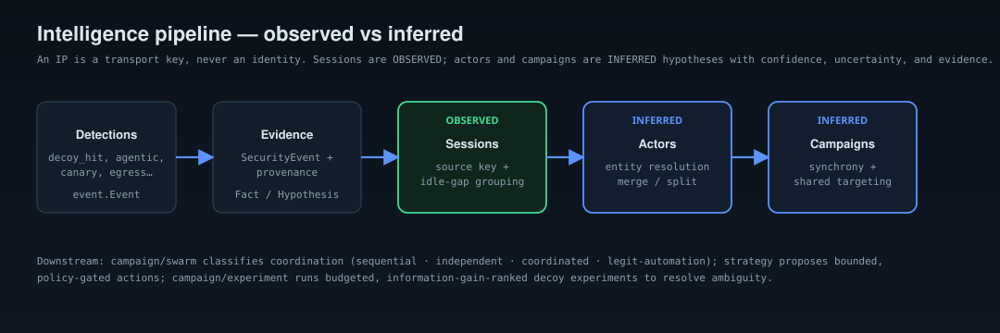
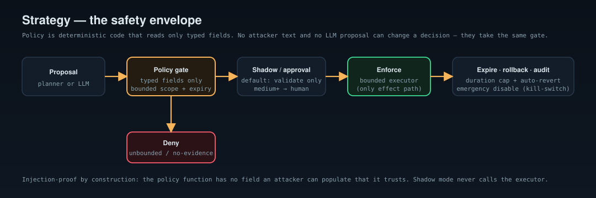

# Heramba architecture — the four planes

Heramba is one binary organized into four cooperating planes, built as modular
Go packages (not microservices). Detections flow **up** from the data plane into
the intelligence plane; intelligence drives **bounded, policy-gated** action in
the adaptive-defense plane; and the research plane exercises the whole stack
under reproducible, measured conditions.

## Data plane

The edge runtime that sits in front of (or beside) your app: it classifies each
source with deterministic behavioral signals, serves decoys and watches
canaries, denies fingerprinting signal, firewalls egress, rate-limits, and
injects counter-agent lures. It emits a stream of `event.Event` detections.
See [architecture.md](../../docs/architecture.md).

## Intelligence plane

Detections are lifted into a **normalized evidence model** with provenance, then
reconstructed into a temporal picture. The cardinal rule: an IP is a transport
key, never an identity. **Sessions are observed; actors and campaigns are
inferred** hypotheses carrying confidence, uncertainty, and the evidence behind
them — and inference is reversible (merge/split correction).

- `internal/evidence` — `Observation`/`Fact`/`Hypothesis`, provenance, store.
- `internal/campaign` — sessionization, entity resolution, temporal graph,
  investigation/explain API.
- `internal/campaign/swarm` — four-class coordination detection (not UA/rate).
- `internal/campaign/experiment` — budgeted, information-gain-ranked active
  learning.
- `internal/evidence/sensor` — multi-sensor (app/auth/network) correlation.
- `internal/intel` — the bridge that wires the live edge into all of the above.

## Adaptive-defense plane

Everything the engine can *do* in response is a typed, bounded action behind a
deterministic policy. Shadow mode is the default (validate + audit, never
enforce); medium-or-higher impact needs human approval; everything expires and
rolls back; an emergency kill-switch stops all enforcement. The policy function
reads only typed fields, so attacker text — and any LLM proposal — cannot change
a decision.

- `internal/strategy` — actions, policy, engine (shadow/approval/expiry/rollback).
- `internal/deception` — the stateful synthetic application served by
  `heramba honeypot`.
- `internal/assetgraph` — separated real vs adversary-visible graphs (real fails
  closed on export) + attack-path hypotheses.
- `internal/bizlogic` — OpenAPI-driven BOLA/IDOR and workflow-sequence detection.

## Research plane

Reproducible evaluation so claims are measured, not asserted: seeded
deterministic scenarios replay through four comparable defenses
(no-defense / static-rules / fixed-deception / adaptive-deception), producing
machine + human reports with mean ± uncertainty. Run it with `heramba
experiment`, or work through the six labs in [`labs/`](../../labs).

- `internal/replay` — scenarios, defenses, metrics, reports.
- `labs/` — six locally-gradable exercises over the real engine.

See the honest per-capability status in
[`../engineering/EXECUTION_STATUS.md`](../engineering/EXECUTION_STATUS.md).
