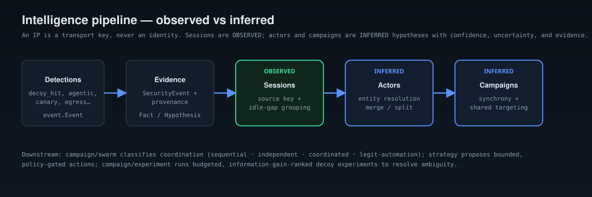

# Campaign intelligence

`internal/campaign` turns a stream of [evidence](evidence.md) into a temporal
picture of who is doing what — while never overstating what it knows.

## Sessions (observed)

The `Sessionizer` groups a transport source key's events into sessions by idle
gap (default 30m). A `Session` asserts nothing about identity — only that these
requests arrived close together from the same source key. It also records a
behavioral **fingerprint** (user-agents, accepts, methods, path-styles, tool
signals, cadence bucket) and any distinctive **identity tokens** (a canary, an
auth subject, a session id).

## Actors (inferred)

The `Resolver` links sessions into `Actor`s — an inference, recorded as a
`Hypothesis`:

- **Same source key** → a strong link (still < 1.0: NAT/CGNAT/proxies mean a
  source key is not an identity).
- **Across source keys** → linked **only** when sessions share a *distinctive
  identity token*, never on generic behavioral similarity. This is deliberate:
  collapsing every user of a common tool (say `nuclei`) into one actor would be
  both wrong and dangerous. Cross-source behavioral similarity is treated as
  *coordination* evidence at the campaign layer, not identity evidence.

False merges are correctable: `Split` pulls a session back out into a fresh
actor and records the contradicting evidence; `Merge` unifies two actors when
later evidence justifies it.

## Campaigns (inferred)

The `Correlator` clusters actors with overlapping active windows and shared
targets into a `Campaign` — again a `Hypothesis` with confidence < 1.0. Richer
coordination analysis lives in [swarm detection](#swarm-coordination).

## Swarm coordination

`internal/campaign/swarm` classifies a cohort of sessions into one of four
classes from explainable features — temporal synchrony, shared/divided
targeting, enumeration breadth, deception contact — **never user-agent or
request rate alone**:

| class | shape |
|---|---|
| `sequential_scanner` | one source enumerating a wide, novel surface |
| `independent_scanners` | several unrelated sources, no synchrony/sharing |
| `coordinated_swarm` | synchronized sources sharing or dividing one surface |
| `legit_automation` | high-volume but narrow, known endpoints, no decoy contact |

The in-repo benchmark reports a confusion matrix on labeled synthetic cohorts.
(It measures on separable synthetic data; real traffic is noisier — the harness
measures, it does not claim field numbers.)

## Investigation & explainability

`Result.ActorTimeline` reconstructs an actor's activity chronologically, marking
each entry observed or inferred. `Result.Explain` prints a provenance-honest
summary that separates the **observed facts** (sessions, source keys, targets,
decoy hits) from the **inferred hypothesis** (the grouping, its confidence and
uncertainty), and flags multi-source actors as identity inference to corroborate
before acting.

## Active learning

When evidence is ambiguous, `internal/campaign/experiment` can run a *budgeted*
decoy experiment to discriminate between competing explanations: hypotheses
carry probabilities, an experiment has a likelihood model, and the registry
picks the highest expected-information-gain experiment it can afford, then
updates posteriors by Bayes. Weak evidence never collapses uncertainty to false
certainty.
