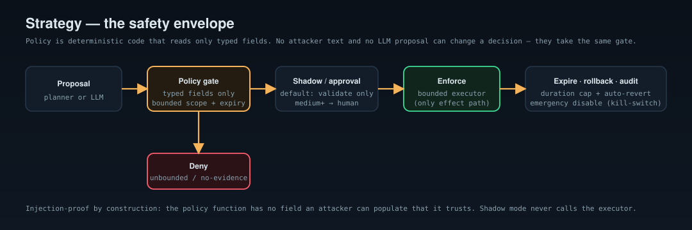

# Strategy & adaptive containment

`internal/strategy` is how Heramba *acts* — and it is built to be adaptive
without ever being unsafe. The design assumes the intelligence feeding it may be
wrong and that attacker-controlled bytes are everywhere, so the safety envelope
is structural.

## Typed, bounded actions

There is a **closed set** of action types: `observe`, `activate_decoy`,
`alter_synthetic`, `rate_limit`, `restrict_session`, `recommend_isolate`,
`escalate`. Every action carries a single bounded **scope** (a source key, a
session id, or a decoy — nothing global), an honest **impact** estimate, a
**duration**, the **evidence** justifying it, and its origin. There are no
free-form actions.

## Deterministic, injection-proof policy

`Policy.Evaluate` is a pure function of an action's **typed fields**. It denies
unbounded scope, over-cap duration, and state changes with no evidence; it gates
medium-or-higher impact behind human approval. It reads **no** free text — not
evidence notes, not the expected-benefit string, not a proposer's claims. That
is what makes prompt injection structurally impossible here: there is no field
an attacker (or a compromised LLM proposal) can populate that the policy trusts.
An LLM may *propose* an action, but the proposal takes exactly the same gate —
there is no path from text to enforcement.

## Shadow by default; approval, expiry, rollback

The `Engine` defaults to **shadow mode**: actions are validated and audited but
never enforced. In enforce mode, the real effect happens only through a bounded
`Executor` — the single external-effect path — and only after policy allows,
approval is granted where required, and the kill-switch is off.

- **Approval** — medium+ impact actions are `pending` until an operator approves.
- **Expiry** — every enforced action has a duration; `Tick` auto-rolls-back on
  expiry.
- **Rollback** — manual `Rollback`, and automatic on expiry or emergency.
- **Emergency disable** — a kill-switch rolls back everything active and blocks
  all new enforcement (fail-safe).
- **Audit** — every lifecycle transition is recorded.

## The planner

`Planner` maps a typed `Situation` (agentic score, deception hit, high-severity
count — no free text) to bounded proposals using transparent rules, ordered
least-to-most impactful. Every proposal is constructed to clear policy; a hot
situation yields a rate-limit and an approval-gated session restriction, never
an unbounded block.

See the lifecycle exercised end-to-end in
[lab 05](../labs/05-adaptive-response).
